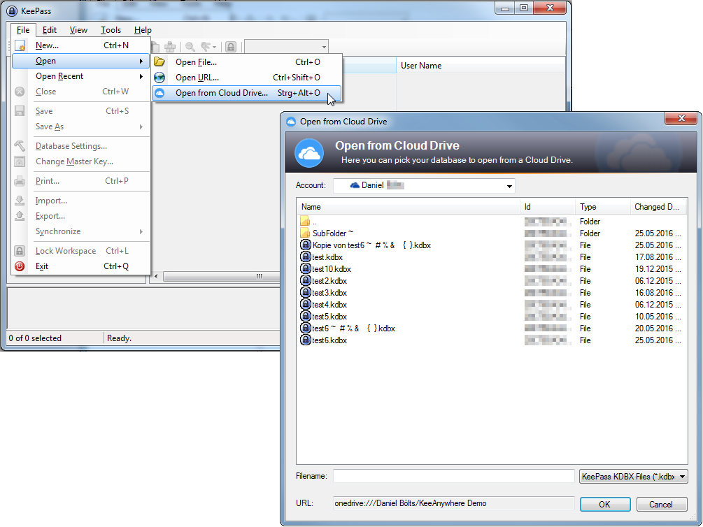

KeeAnywhere is a [KeePass Password Safe](https://keepass.info) plugin that provides access to cloud storage providers (cloud drives). The main goal is to offer a simple UI while integrating deeply into KeePass. This covers all kind of users: novices, experienced and power users.

# Project Status
*Status as of November 2026 - latest release: [{{ site.github.latest_release.tag_name }}]({{ site.github.latest_release.html_url }}) ({{ site.github.latest_release.published_at | date: "%Y-%m-%d" }})*

KeeAnywhere is actively maintained. I intend to keep the libraries up to date (especially for security fixes), adapt to API changes of the storage providers, fix bugs, implement smaller improvements, review pull requests and publish releases regularly.

KeeAnywhere is developed in my spare time, so I can't make binding commitments - there are no guaranteed response times or release dates. If I can't maintain KeeAnywhere anymore, I'll say so here.

# Supported providers (in alphabetical order)
**Maintained** - maintained and tested by me:
* Amazon AWS S3
* Box
* Dropbox
* Google Drive
* HiDrive
* OneDrive

**Community-driven** - contributed and tested by the community, see [Contribute](contribute#community-driven-providers):
* Amazon S3 compatible services (e.g. MinIO and other self-hosted S3 servers)
* Azure (Blob and File storage)
* Google Cloud Storage

# Key features
* Support for multiple cloud storage providers
* Support for multiple accounts for each cloud storage provider
* Open/Save databases with a feature rich user interface
* Easy and intuitive configuration
* Access to cloud stored databases via URL ("Open from URL"/"Save to URL")
* Full support of recent files list
* Deep integration into KeePass' core functions (synchronization, triggers, scripting, etc.)
* No need for technical configuration entries in a database
* No need to have cloud storage provider's native client be installed
* Proxy support
* Simple Automatic Backup
* Offline Caching

# License
The source code is licensed under the [MIT license](https://github.com/Kyrodan/KeeAnywhere/blob/master/LICENSE).